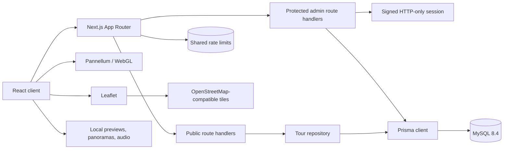
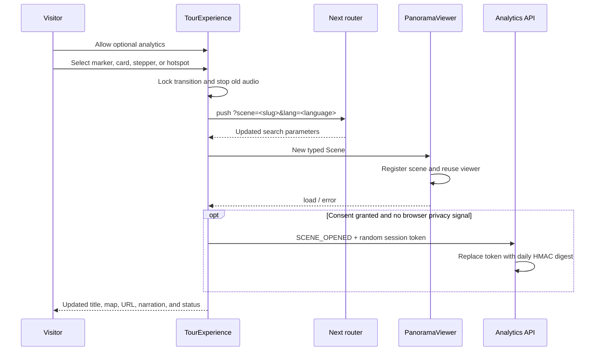

# Architecture

## System overview

Da Nang 360 Explorer is a Next.js App Router application. Public pages and route
handlers share typed domain models, while Prisma provides the production MySQL
repository. When `DATABASE_URL` is absent in development or tests, the public
read-only tour uses bundled demo data; production never enables that fallback.
Authentication and administrator mutations always require MySQL.

## Component responsibilities

- `TourExperience` is the synchronization boundary for active scene, URL,
  language, map, side panels, audio stop behavior, opt-in analytics, and
  transition throttling.
- `ViewerStateContext` exposes the active scene, language, and transition state
  to nested viewer features; the live scene announcer consumes it without
  duplicating navigation state.
- `PanoramaViewer` owns one persistent Pannellum instance. It dynamically
  imports the browser library, registers scene configurations on demand, reports
  view state, reuses the WebGL canvas across scene changes, and destroys the
  viewer only on retry or unmount.
- `lib/pannellum/config.ts` converts application scenes and hotspots into typed
  Pannellum configuration without leaking UI state into the viewer library.
- `SceneSidebar`, `TourMapModal`, and scene-link hotspots all call the same
  `selectScene` function.
- Route handlers validate unknown input with Zod and always return the documented
  success or failure envelope.
- `proxy.ts` performs an optimistic signed-cookie check. The protected layout and
  mutation handlers repeat authorization server-side.

## Data flow

## Panorama lifecycle

Without consent, the analytics branch is skipped and all tour behavior remains
available. The preview is visible before the dynamic Pannellum import completes. Active
panorama assets start loading in parallel with that import. One viewer is
created for the tour and Pannellum's scene API replaces textures and hotspots
without repeatedly creating WebGL contexts. Only the likely next preview is
scheduled during browser idle time, and speculative loading is disabled for
data-saver, reduced-data, and 2G connections. Cleanup calls `destroy` on retry
or unmount. The public interface remains rendered if initialization fails.

## Authentication flow

Login is same-origin and rate-limited. Development uses a process-local
fixed-window adapter; production uses an atomic Redis fixed window shared by all
instances. The password hash is read from MySQL and verified with bcrypt. A
signed, eight-hour, HTTP-only, `SameSite=Strict` cookie is issued; production
also sets `Secure`. The browser never receives a password hash. Logout expires
the cookie. State-changing administrator routes require a valid signed session
and same-origin request.

## Deployment boundaries

Vercel should use a managed MySQL service reachable from serverless functions
and an Upstash Redis database reachable through its REST API. Run migrations
from CI or a controlled release job, not at request time. Docker uses a separate
Next.js container and a health-checked MySQL 8.4 service. Production refuses to
fall back to process-local throttling or bundled tour data. The read-only
`/api/health` readiness route validates core environment values, storage,
analytics privacy, rate-limit configuration, and database connectivity before
traffic is accepted. `/api/health/live` checks only the process and is used by
the container runtime, preventing dependency outages from creating restart
loops. The read-only deployment verifier checks both endpoints and confirms an
existing published tour after each rollout.
