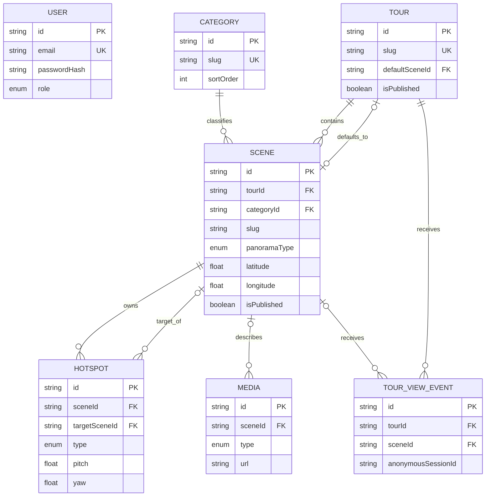

# Database design

The schema is normalized around tours, categorized scenes, scene-owned
hotspots, reusable media metadata, privacy-minimized events, and administrator
users.
Coordinates and view angles use floating-point columns; `multiresConfig` is JSON
because Pannellum tile layouts are provider-specific.



Tour slugs are globally unique; scene slugs are unique inside a tour. Publication
and sort fields are indexed with their parent IDs. Deleting a scene cascades its
owned hotspots only after the administrator confirms deletion. Hotspots from
other scenes that target the deleted scene are preserved with `targetSceneId`
set to null, so broken graph edges can be diagnosed instead of destroying
unrelated content. Tour and category deletion is restricted while scenes refer
to the record. Media becomes unassigned when its scene is removed.

`TOUR_VIEW_EVENT.anonymousSessionId` is a legacy-compatible field name. New
events store a purpose-separated, daily rotating HMAC-SHA256 digest rather than
the browser session token. The existing table and rows are not migrated or
rewritten. The configurable retention command is documented in
[analytics privacy](privacy.md).

Apply the checked-in migration with:

```bash
npm run db:migrate:deploy
```

For a new development migration, change `schema.prisma`, run
`npm run db:migrate`, review the SQL, and update this document.

## Isolated integration testing

`npm run test:integration` requires `INTEGRATION_DATABASE_URL`. The target
must use MySQL or MariaDB, have a database name containing a separate `test`
marker, and differ from the application `DATABASE_URL`. The runner applies
checked-in migrations to that target before Vitest starts.

Integration fixtures use unique slugs and retain their exact generated IDs.
Cleanup filters only those IDs and follows foreign-key dependency order. A
sentinel tour verifies that unrelated rows survive the complete administrator
create, update, relationship, and delete workflow.
